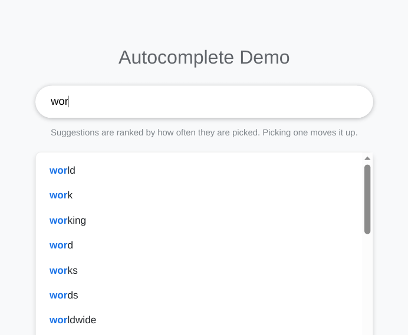

# Search Autocomplete Engine

**Live demo:** https://search-autocomplete-engine.onrender.com

[](https://github.com/krishbuilds01/Search-Autocomplete-Engine/actions/workflows/ci.yml)

An autocomplete API in Node.js and Express. You type a prefix, it returns matching words ranked by how often they get picked, the way real search boxes behave. Results come from a custom Trie held in memory, with Redis caching in front of it and MongoDB as the store.



## What it does

- Prefix search over 58,000+ words, served from an in-memory Trie
- Results ranked by popularity, not alphabet. Every selection is counted, and words people pick rise to the top
- Starting popularity comes from a public word frequency list (google-10000-english), so common words rank first from day one
- Typo tolerance: if a prefix matches nothing, it falls back to edit-distance search (try `wrok` or `computter`)
- Redis cache with a 60 second TTL. When a word is picked, only the cache keys for its prefixes are cleared, so the new ranking shows up at once
- Rate limiting on the search and tracking endpoints, plus an optional admin token for writes
- Health and stats endpoints. Stats reports the live cache hit rate since startup

## Numbers

Measured locally on a small VM (1.5 vCPU, Node 24, MongoDB and Redis on localhost, 50,000 words):

- About 0.9 ms average latency for a single search
- About 4,100 requests per second with 50 concurrent clients, zero errors
- 98% cache hit rate on a repeated 20 query pool

These are local numbers on small hardware, not production benchmarks.

## How ranking works

Each word has a `searchCount`. It starts from the word's rank in the frequency list (the most common English word starts at 10,000) and goes up by 1 every time someone selects that word through `POST /track`. The Trie keeps the count next to each word and sorts matches by count first, then alphabetically. Counts live in MongoDB, so rankings survive restarts.

The Trie also indexes the later words of multi-word entries, so searching `athletic` finds `grey athletic shorts`.

## API

| Endpoint | What it does |
| --- | --- |
| `GET /autocomplete?q=wor` | Suggestions for a prefix, ranked. Optional `limit` (default 20, max 50) |
| `POST /track` | Body `{ "value": "work" }`. Records a selection and re-ranks |
| `POST /items` | Add or update a word. Needs `x-admin-token` if `ADMIN_TOKEN` is set |
| `DELETE /items/:itemId` | Remove a word |
| `GET /health` | Status, item count, Redis state |
| `GET /stats` | Request counts and cache hit rate since startup |
| `GET /docs` | Swagger UI |

## Run it

With Docker (app, MongoDB and Redis together):

```bash
docker compose up --build
docker compose --profile seed run seed
```

The seed profile loads the 10,000 word frequency list as a starter dataset. For the full 50,000 word dataset, pass a bigger dictionary file to `seed.js`.

Without Docker:

```bash
npm install
npm start
```

Needs MongoDB on `localhost:27017`. Redis is optional; without it the API still works, just with no cache. Copy `.env.example` to `.env` to change ports, URLs or set an `ADMIN_TOKEN`.

## Tests

```bash
npm test
```

Unit tests for the Trie (ranking, fuzzy search, weights) and integration tests that boot the real server and exercise the API end to end. CI runs both, plus a Docker build, on every push.

## Stack

Node.js, Express 5, MongoDB with Mongoose, Redis, vanilla JS demo page, Swagger UI.
